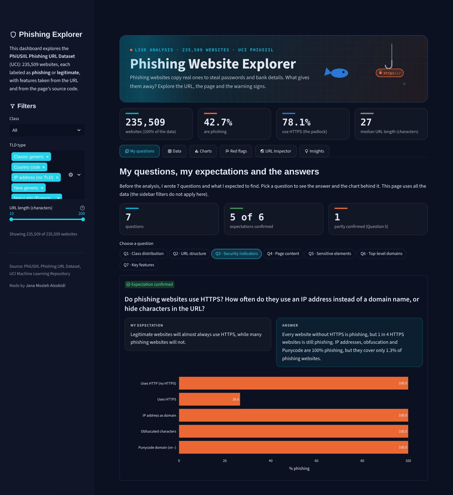

# Phishing Website Analysis

Exploratory data analysis and an interactive Streamlit dashboard of the **PhiUSIIL Phishing URL Dataset**.
The goal of this project is to find out what makes phishing websites different from legitimate ones,
and which signs can help people spot them.

**Unit 3 Final Project** · Tuwaiq Academy, Data Analysis and Artificial Intelligence Bootcamp · Jana Mosleh Alzobidi



## Dataset

| | |
|---|---|
| **Name** | PhiUSIIL Phishing URL Dataset |
| **Source** | [UCI Machine Learning Repository](https://archive.ics.uci.edu/dataset/967/phiusiil+phishing+url+dataset) |
| **Size** | 235,795 websites and 55 columns (235,509 rows after cleaning) |
| **Target** | `label`: 1 = legitimate, 0 = phishing |

The features come from the URL itself (length, digits, special characters, TLD) and from the webpage
(HTTPS, title, password fields, images, links). The notebook loads the data directly from UCI with the
`ucimlrepo` library, so the original file is not included in this repository.

## Questions

1. How many phishing and legitimate websites are there? Is the data balanced?
2. Are phishing URLs longer? Do they have more digits, special characters or subdomains?
3. Do phishing websites use HTTPS? How often do they use an IP address instead of a domain name, or hide characters in the URL?
4. Are phishing pages smaller and simpler? Do they have a title, a favicon, a description or copyright information?
5. Do phishing pages have more password fields, hidden fields, or words like "bank", "pay" and "crypto"?
6. Which endings (`.com`, `.org`, `.app`, ...) have the highest share of phishing websites?
7. Which features are most related to the label?

## Key findings

- **HTTPS does not mean safe:** about 1 in 4 websites that use HTTPS is phishing.
- **Phishing pages are minimal:** the median phishing page has 12 lines of code, compared to 1,105 for legitimate pages.
- **Trust signals are missing on phishing pages:** under 1% link to social media, compared to 79% of legitimate pages.
- **Some TLDs are risky:** new generic TLDs (`.app`, `.dev`, `.top`, ...) are 93.8% phishing, while `.gov` and `.edu` are almost never phishing.
- **Page size hides the real pattern for password fields:** overall they are more common on legitimate pages, but among pages of similar size, phishing pages have them 3 to 7 times more often.
- **No single feature is enough:** the rarest signs (IP addresses, obfuscation, Punycode) are 100% phishing but catch only 1.3% of phishing websites.

## Limitations

- All legitimate websites are homepages in the form `https://www.domain` with at least 102 lines of code.
- `URLSimilarityIndex` is exactly 100 for every legitimate website, which makes it partly circular.
- Some features were extracted with errors (for example, `IsHTTPS` for 493 URLs, which was fixed during cleaning).

So some differences come from how the dataset was built, not only from how phishing websites behave.

## Project structure

```
phishing-url-eda/
├── README.md
├── requirements.txt
├── .streamlit/
│   └── config.toml              # dashboard theme
├── notebook/
│   └── phishing_eda.ipynb       # full analysis: loading, cleaning, EDA, insights
├── app/
│   ├── app.py                   # Streamlit dashboard
│   └── phishing_clean.csv.gz    # cleaned dataset
├── report/
│   └── phishing_eda_report.pdf  # project report
├── presentation/
│   └── phishing_eda_slides.pdf  # final presentation
└── images/
    └── dashboard.png
```

## How to run the dashboard

1. Install the libraries:
   ```
   pip install -r requirements.txt
   ```
2. Run the app from the main folder:
   ```
   streamlit run app/app.py
   ```

The dashboard supports light and dark mode (it follows your system setting, or change it from the app menu: Settings → Theme). It has a sidebar with filters (class, TLD type and URL length) and three tabs:
**Data** (preview and summary statistics), **Charts** (interactive visualizations) and **Insights**.

## Tools

Python, pandas, NumPy, Matplotlib, seaborn, Plotly and Streamlit.
